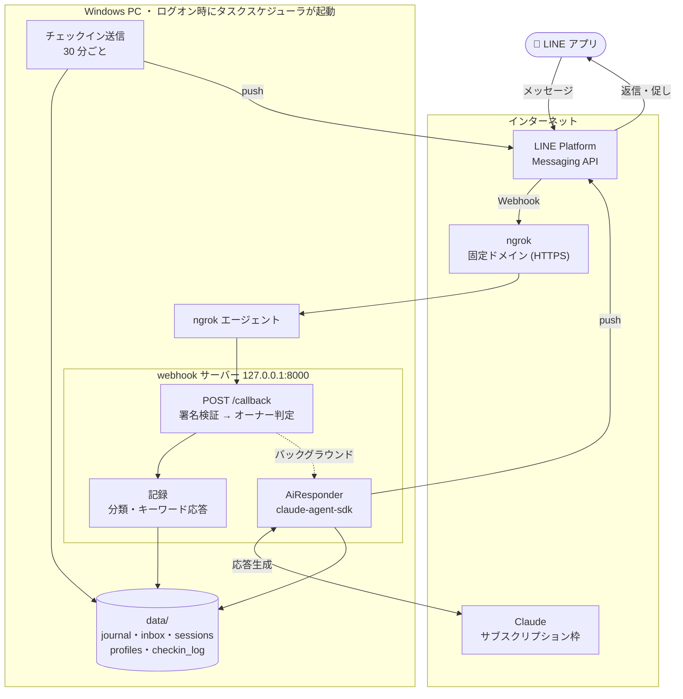
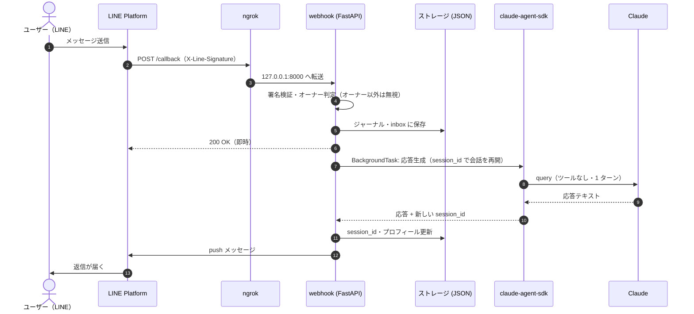
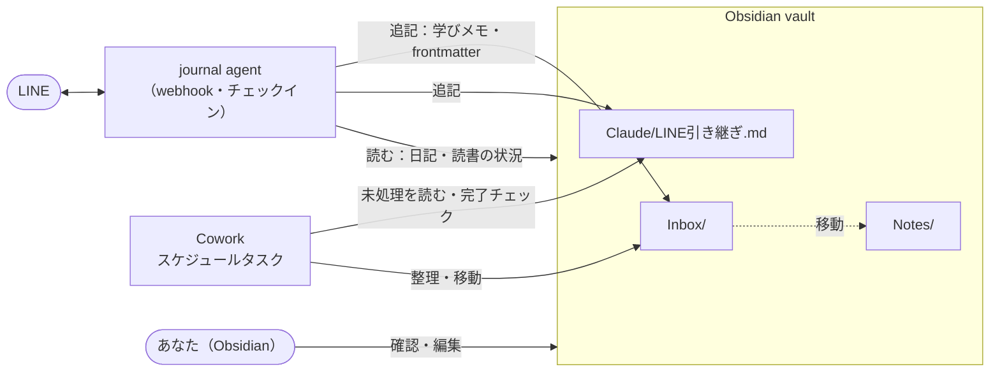

# システム構成

AI Journaling Agent の現在の構成（ADR-0004 + Windows 常駐運用）と、計画中の Obsidian / Cowork 連携をまとめる。
1 人 1 インスタンス前提：各ユーザーが自分の LINE チャネル・自分の Claude サブスクリプション・自分の PC で動かす。

## 全体図

## メッセージ 1 通の流れ

## 構成要素

| 要素 | 役割 | 実体 |
|---|---|---|
| webhook サーバー | LINE からのイベント受信、記録、AI 応答 | `src/ai_journaling_agent/adapters/line/bot.py` |
| オーナー判定 | `OWNER_USER_ID` 以外のイベントを無視。未設定なら全て無視 | `is_owner_event()` |
| AiResponder | claude-agent-sdk で応答生成。session_id で会話を継続、失効時は新規セッション | `core/ai_responder.py` |
| チェックイン | 朝・昼・夕・夜に未送信なら促しを push | `core/checkin.py`, `scripts/windows/run-checkin.ps1` |
| トンネル | LINE から届く固定 HTTPS URL を PC へ中継 | ngrok（`NGROK_DOMAIN`） |
| 常駐 | ログオン時に webhook とトンネルを起動、落ちたら再起動 | `scripts/windows/register-tasks.ps1` |
| データ | ジャーナル・inbox・セッション・プロフィール | `~/.ai-journaling-agent/data`（`STORAGE_DIR`） |
| ログ | 月ごとのファイル | `~/.ai-journaling-agent/logs` |

## 計画中：Obsidian / Cowork 連携

- **journal agent（LINE）**：記録の入口。✅ 実装済み：`VAULT_DIR` を設定するとチェックインに促しを添える（夜：日記が未記入なら / 土日の朝：しばらく開いていない本。論文は会話で話題になったときだけ）。計画中：会話から学びメモを `Inbox/` に追記し、デイリーノートの frontmatter を埋める。本文はユーザーの言葉のまま。
- **引き継ぎメモ**：`Claude/LINE引き継ぎ.md` に journal agent が追記するチェックリスト。
- **Cowork**：スケジュールタスクで引き継ぎメモを処理し、Inbox → Notes の整理を行う。破壊的操作は確認待ちとしてメモに残す。
